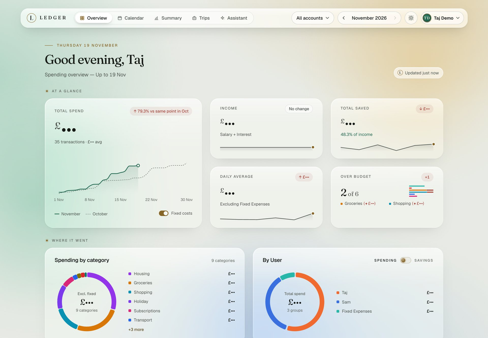
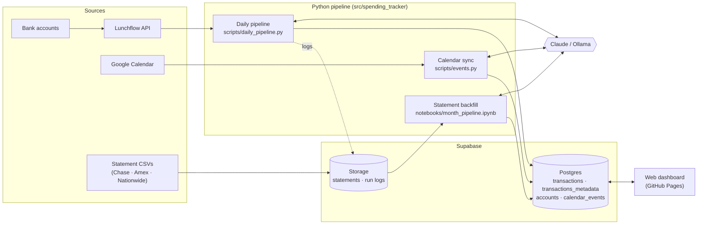
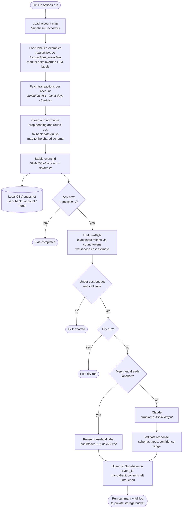
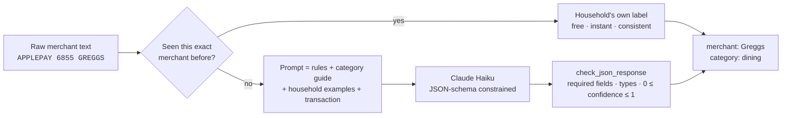
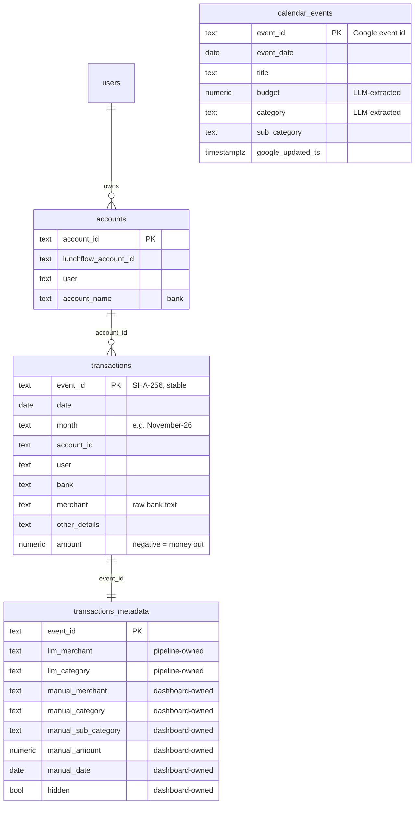

<div align="center">

# Ledger

**An automated household spending tracker: bank feeds in, clean and categorised transactions out.**

A Python pipeline pulls transactions from every household bank account, cleans and de-duplicates them, and
categorises them with Claude, learning from the household's own corrections. Everything lands in Supabase,
where a lightweight web dashboard reads it.


<picture>
  <source media="(prefers-color-scheme: dark)" srcset="assets/readme/dashboard-dark.jpg">
  
</picture>

<sub>The dashboard with demo data, shown in discreet mode, which masks every money figure.</sub>

</div>

---

## Contents

- [How it works](#how-it-works)
- [The daily pipeline](#the-daily-pipeline)
- [Categorisation](#categorisation)
- [Cost guardrails](#cost-guardrails)
- [Data model](#data-model)
- [Other ingestion paths](#other-ingestion-paths)
- [Logging and observability](#logging-and-observability)
- [Project layout](#project-layout)
- [Getting started](#getting-started)
- [Dashboard](#dashboard)

---

## How it works



There are three ways data gets in. All three share the same cleaning, categorisation and upload code:

| Path | Source | Trigger | Writes to |
| --- | --- | --- | --- |
| **Daily pipeline** | Lunchflow open-banking API | GitHub Actions | `transactions`, `transactions_metadata` |
| **Calendar sync** | Google Calendar | Local script | `calendar_events` |
| **Statement backfill** | Bank CSV exports uploaded from the dashboard | Notebook | `transactions`, `transactions_metadata` |

---

## The daily pipeline

[`scripts/daily_pipeline.py`](scripts/daily_pipeline.py) is the main entry point. It runs on a GitHub-hosted
runner through [`.github/workflows/daily-pipeline.yml`](.github/workflows/daily-pipeline.yml). Each run fetches
the last few days of transactions for every connected account and takes them all the way to the database.



### Stage by stage

1. **Account map.** The `accounts` table maps each Lunchflow account id to a household member, bank and
   account number. Adding an account to the pipeline means adding a row there; no code changes.
2. **Labelled examples.** Every categorised transaction since a cut-off date is loaded, joined with its
   metadata. Manual corrections made in the dashboard (`manual_category`, `manual_merchant`) win over the LLM's
   earlier answer. This set acts as both a lookup table and few-shot context for the model.
3. **Fetch.** One `GET /accounts/{id}/transactions?from=…` per account, covering the last `num_days_lag` days
   (5 by default). The overlap is deliberate: it catches late-settling transactions, and the upserts make
   reprocessing harmless.
4. **Clean.** [`data_processing/lunchflow.py`](src/spending_tracker/data_processing/lunchflow.py) normalises
   the raw feed into the shared transaction schema:
   - only **settled** transactions are kept, because pending ones can change id or amount when they settle;
   - savings round-ups are dropped;
   - bank-specific fixes are applied (Nationwide dates arrive a day late and are shifted back);
   - `processing_month` (used for partitioning) is kept separate from the transaction's own `month`.
5. **Identity.** Each row gets an `event_id`: a SHA-256 hash of the source account, Lunchflow transaction id,
   user, bank and account. The same transaction always hashes to the same id. That makes every write an
   idempotent upsert, so re-running a day can never create duplicates.
6. **Pre-flight, then categorise.** See [Categorisation](#categorisation) and
   [Cost guardrails](#cost-guardrails).
7. **Upload.** Rows are upserted into `transactions` and `transactions_metadata` on `event_id`. The metadata
   upsert **excludes** the `manual_*` and `hidden` columns, so a re-run never overwrites a correction someone
   made in the dashboard.

---

## Categorisation

Categorisation is a two-tier hybrid: a deterministic lookup first, with the LLM as fallback.
[`classification/classify.py`](src/spending_tracker/classification/classify.py) handles the routing.



**Why a hybrid?** Most spending repeats: the same supermarket, the same commute, the same subscriptions.
Looking those up costs nothing and always agrees with what the household chose before. The LLM only sees
merchants it hasn't met yet, so cost scales with *new* merchants, not with transaction volume. Each correction
made in the dashboard becomes a labelled example for the next run.

**The prompt** ([`classification/prompts.py`](src/spending_tracker/classification/prompts.py)) asks for two
things at once:

- **A tidy merchant name.** It strips payment-method noise (`Contactless`, `APPLEPAY`, `SQ *`), reference codes
  and town names, and expands abbreviations (`TFL` → *Transport for London*, `AMZN MKTP` → *Amazon*). It also
  labels person-to-person payments as *Transfer to/from …*.
- **One of 15 categories,** chosen with sign-aware rules: a positive amount from a shop is a `refund`, while
  `salary`, `interest` and `refund` are never valid for money going out. `other` is a last resort.

**Structured output.** Requests use a JSON schema
([`llm_schemas.json`](src/spending_tracker/classification/llm_schemas.json)) whose `category` field is an
`enum`, so the model can't invent a category. Every reply is still parsed and type-checked before use, and a
malformed reply fails loudly rather than writing bad data.

**Pluggable models.** The same call path can use either backend:

| Backend | Model | Used for | Notes |
| --- | --- | --- | --- |
| `claude` | `claude-haiku-5-5` | CI / production | Thinking off, low effort, `max_tokens=512` |
| `ollama` | `qwen3:8b` | Local development | Free; the run fails if the prompt nears the context limit, rather than letting it be silently truncated |

Set the backend with `LLM_MODEL=claude|ollama`.

---

## Cost guardrails

An unattended job that calls a paid API needs hard limits. The pipeline has three layers, and each is checked
**before** anything is sent:

| Guard | Where | What it does |
| --- | --- | --- |
| **Pre-flight estimate** | `classify.estimate_llm_run` | Builds every real prompt and counts its tokens exactly with Anthropic's free `count_tokens` endpoint. It assumes every reply hits `max_tokens` to get a worst-case cost. |
| **Run budget** | `MAX_LLM_COST_USD` (default `$0.05`) | If the worst case exceeds the budget, the run aborts before the first LLM call and exits non-zero. |
| **Call cap** | `claude.DEFAULT_MAX_CALLS_PER_RUN` (20) | A hard ceiling inside the client itself, so a bug or an accidental backfill can't run up a bill even if the estimate is bypassed. |

On top of that, **dry run** mode (the default when triggering the workflow manually) does the fetch, clean and
pre-flight, prints the estimate, then stops before any LLM call or database write.

The workflow also uses a `concurrency` group, so two runs can never upsert at the same time, plus a 10-minute
timeout.

---

## Data model



The schema is split so each writer has its own columns:

- **`transactions`** holds the bank's facts. Only the pipeline writes them, and they are never edited.
- **`transactions_metadata`** holds interpretation. The `llm_*` columns belong to the pipeline; the `manual_*`
  columns and `hidden` belong to the dashboard. The dashboard shows `manual_* ?? llm_* ?? raw`, and the
  pipeline's upsert excludes the manual columns, so neither side can overwrite the other.

Column lists live in one place: [`data_processing/table_schema.py`](src/spending_tracker/data_processing/table_schema.py).

---

## Other ingestion paths

### Calendar sync: planned spending

[`scripts/events.py`](scripts/events.py) reads Google Calendar (read-only OAuth) from the start of last month
to a year ahead. For each event, the LLM extracts a **budget**, a **category** and, for holidays, a
**sub-category** (flights, stay, food…) from the free-text title and description. The dashboard uses these for
spending forecasts and trip budgets.

The sync is incremental. An event whose Google `updated` timestamp hasn't changed reuses its stored extraction,
so a typical run makes almost no LLM calls. Events deleted from the calendar are deleted from the table, but
only when the fetch returned something, so an empty or failed fetch can't wipe the table.

### Statement backfill: CSV exports

For history from before Lunchflow, or accounts it doesn't cover, statements can be uploaded from the dashboard
to Supabase Storage:

```
spending-tracker/data/transactions/raw/<user>/<bank>/<account_id>/<Month-YY>/statement.csv
```

[`notebooks/month_pipeline.ipynb`](notebooks/month_pipeline.ipynb) downloads a month's files and runs
[`statements.parse_and_clean_batch`](src/spending_tracker/data_processing/statements.py). That function sends
each file to a bank-specific loader and cleaner (`chase.py`, `amex.py`, `nationwide.py`), then runs the same
categorisation and upsert as the daily pipeline. CSV exports carry no stable transaction id, so these cleaners
build the `event_id` from date, amount, description and an occurrence counter. The counter keeps two genuinely
identical purchases on the same day separate.

---

## Logging and observability

Logging is built on [loguru](https://github.com/Delgan/loguru) and configured in
[`logging_config.py`](src/spending_tracker/logging_config.py). The repo is public, so its GitHub Actions logs
are public too, and logging is designed around that:

- **Two audiences.** Only lines marked `logger.bind(public=True)` (counts, costs, statuses) reach the GitHub
  console. Merchants, amounts and per-account detail go only to the full DEBUG log file.
- **Logs survive the runner.** At the end of a run, the log file is uploaded to a private Supabase Storage
  bucket (`pipeline-logs`) under its outcome: `completed/`, `dry_run/`, `aborted/` or `failed/`. The 10 newest
  are kept per folder. Crashes are caught by an `atexit` hook and filed under `failed/`, and on GitHub an
  uncaught exception shows only its type, with the traceback kept in the private log.
- **Run summary.** Every run, including dry runs and aborts, ends with a metrics table: accounts, fetched and
  kept counts, the pre-flight estimate against the budget, actual tokens and cost per call, and rows upserted.
  On GitHub, a totals-only version is also written to the run's **Summary** page.

```text
── Daily pipeline summary ─────────────────────────
  Run
    Status                       completed
    LLM model                    claude
    Duration                     14.2s
  Totals
    Accounts                     6 (4 with new transactions)
    Transactions fetched         31
    Transactions kept (settled)  27
  LLM estimate (pre-flight)
    calls                        3
    worst case                   $0.0021
    budget                       $0.0500
  LLM usage (actual)
    calls                        3
    cost                         $0.0016
  Supabase upserts
    transactions                 27 rows
    transactions_metadata        27 rows
```

<sub>Illustrative output.</sub>

---

## Project layout

```text
.
├── src/spending_tracker/
│   ├── classification/
│   │   ├── classify.py          # routing (lookup vs LLM), validation, pre-flight cost estimate
│   │   ├── claude.py            # Anthropic client, pricing, call cap, token counting
│   │   ├── ollama.py            # local model backend
│   │   ├── prompts.py           # categorisation + calendar-extraction prompts, category lists
│   │   └── llm_schemas.json     # JSON schemas for structured output
│   ├── data_ingestion/
│   │   ├── cal.py               # Google Calendar fetch + incremental extraction
│   │   ├── csv_parsing.py       # batch loading of partitioned CSVs
│   │   └── pdf_parsing.py       # PDF tables + raw-statement discovery
│   ├── data_processing/
│   │   ├── lunchflow.py         # Lunchflow API client + cleaner
│   │   ├── chase.py · amex.py · nationwide.py   # per-bank statement cleaners
│   │   ├── statements.py        # statement batch processing, metadata table builder
│   │   ├── common.py            # event_id hashing, partitioned CSV upserts
│   │   └── table_schema.py      # single source of truth for column lists
│   ├── database/                # Supabase client, fetches, upserts, deletes
│   └── logging_config.py        # public/private logging, log upload, run summary
├── scripts/
│   ├── daily_pipeline.py        # main entry point (CI)
│   ├── events.py                # calendar sync
│   └── delete.py                # remove a month of transactions + metadata
├── notebooks/                   # backfills, one-off loads and exploration
├── dashboard/                   # static web front end (see below)
└── .github/workflows/
    ├── daily-pipeline.yml       # runs the pipeline
    └── deploy-pages.yml         # builds + deploys the dashboard on dashboard/** changes
```

---

## Getting started

### Prerequisites

- Python 3.12 and [uv](https://docs.astral.sh/uv/)
- A Supabase project with the tables above
- A [Lunchflow](https://www.lunchflow.app) API key, with bank accounts connected
- An Anthropic API key, or a local [Ollama](https://ollama.com) with `qwen3:8b` pulled

### Install

```bash
uv sync
```

### Configure

Create a `.env` file at the repo root (it is gitignored):

```dotenv
SUPABASE_URL=https://<project-ref>.supabase.co
SUPABASE_SERVICE_ROLE_KEY=...
LUNCHFLOW_API_KEY=...
ANTHROPIC_API_KEY=...
```

Optional runtime settings:

| Variable | Default | Purpose |
| --- | --- | --- |
| `LLM_MODEL` | `claude` | `claude` or `ollama` |
| `LLM_DRY_RUN` | `true` | Estimate only: no LLM calls, no uploads |
| `MAX_LLM_COST_USD` | `0.05` | Abort if the worst-case estimate exceeds this |
| `LOG_LEVEL` | `INFO` | Console level (the log file is always DEBUG) |

The fetch window, the labelled-example cut-off and `force_llm` (send every row to the LLM, even known
merchants) are set at the top of `scripts/daily_pipeline.py`.

### Run

```bash
uv run python scripts/daily_pipeline.py   # daily pipeline
uv run python scripts/events.py           # calendar sync (opens a browser for Google OAuth on first run)
```

### Run on GitHub Actions

1. Add `SUPABASE_URL`, `SUPABASE_SERVICE_ROLE_KEY`, `LUNCHFLOW_API_KEY` and `ANTHROPIC_API_KEY` under
   **Settings → Secrets and variables → Actions**.
2. Create a private Storage bucket called `pipeline-logs` in Supabase.
3. **Actions → Daily transactions pipeline → Run workflow.** The *Dry run* box is ticked by default.
4. To run it on a schedule, uncomment the `schedule:` block in the workflow (06:00 UTC).

### Lint

```bash
uv run ruff check . && uv run ruff format .
```

---

## Dashboard

The front end is a dependency-free static site (plain HTML, CSS and ES modules) in [`dashboard/`](dashboard/).
It reads Supabase directly, with Google sign-in and row-level security limiting access to the household. It
covers monthly overviews, budgets, a calendar, trip planning, in-place editing of transactions and statement
uploads. It installs as an offline-capable PWA.

<details>
<summary><b>Running and deploying the dashboard</b></summary>

#### Run locally

```bash
cp dashboard/js/config.example.js dashboard/js/config.js   # add your Supabase URL + anon key
python3 -m http.server 8000                                # then open http://localhost:8000/dashboard/
```

To try the production build: `npm install --no-save esbuild@0.24.0`, then
`node dashboard/tools/build.mjs dashboard build/dashboard` and serve `build/dashboard`.

#### Sign-in

Google is the only sign-in method.

1. In Google Cloud Console, create an OAuth client and add
   `https://<project-ref>.supabase.co/auth/v1/callback` as a redirect URI.
2. Enable the Google provider in **Supabase → Authentication → Providers**.
3. Add the dashboard URLs, local and deployed, to **Authentication → URL Configuration → Redirect URLs**.
4. Add household emails to the `users` table. RLS policies check it, so a Google account that isn't listed
   is signed straight back out.

#### Deploy to GitHub Pages

[`deploy-pages.yml`](.github/workflows/deploy-pages.yml) runs on pushes that touch `dashboard/**`. It generates
`config.js` from the `SUPABASE_URL` and `SUPABASE_ANON_KEY` secrets, bundles and fingerprints the assets with
esbuild, and writes the service worker. Set **Settings → Pages → Source** to **GitHub Actions**. The anon key
still ships in the browser bundle (it has to); access control comes from RLS, not from keeping the key secret.

</details>

<details>
<summary><b>Supabase policies for dashboard features</b></summary>

All policies use the same household check:

```sql
exists (select 1 from public.users u where u.email = auth.jwt() ->> 'email')
```

**Statement uploads** (`storage.objects`, bucket `spending-tracker`). These need insert, select and update,
because uploads use `upsert`:

```sql
create policy "Household can upload statements" on storage.objects
  for insert to authenticated
  with check (bucket_id = 'spending-tracker' and name like 'data/transactions/raw/%'
    and exists (select 1 from public.users u where u.email = auth.jwt() ->> 'email'));

create policy "Household can read statements" on storage.objects
  for select to authenticated
  using (bucket_id = 'spending-tracker' and name like 'data/transactions/raw/%'
    and exists (select 1 from public.users u where u.email = auth.jwt() ->> 'email'));

create policy "Household can replace statements" on storage.objects
  for update to authenticated
  using (bucket_id = 'spending-tracker' and name like 'data/transactions/raw/%'
    and exists (select 1 from public.users u where u.email = auth.jwt() ->> 'email'));
```

**Trips:**

```sql
create table public.trips (
  id bigint generated always as identity primary key,
  location text not null,
  start_date date not null,
  end_date date not null check (end_date >= start_date),
  budget numeric,
  part_budgets jsonb not null default '{}'::jsonb,
  created_at timestamptz not null default now()
);
alter table public.trips enable row level security;

create policy "Household can read trips" on public.trips for select to authenticated
  using (exists (select 1 from public.users u where u.email = auth.jwt() ->> 'email'));
create policy "Household can add trips" on public.trips for insert to authenticated
  with check (exists (select 1 from public.users u where u.email = auth.jwt() ->> 'email'));
create policy "Household can update trips" on public.trips for update to authenticated
  using (exists (select 1 from public.users u where u.email = auth.jwt() ->> 'email'))
  with check (exists (select 1 from public.users u where u.email = auth.jwt() ->> 'email'));
create policy "Household can delete trips" on public.trips for delete to authenticated
  using (exists (select 1 from public.users u where u.email = auth.jwt() ->> 'email'));
```

**Monthly budgets** (`month` text unique, e.g. `'2026-10'`; `budgets` jsonb):

```sql
alter table public.monthly_budgets enable row level security;

create policy "Household can read budgets" on public.monthly_budgets for select to authenticated
  using (exists (select 1 from public.users u where u.email = auth.jwt() ->> 'email'));
create policy "Household can add budgets" on public.monthly_budgets for insert to authenticated
  with check (exists (select 1 from public.users u where u.email = auth.jwt() ->> 'email'));
create policy "Household can update budgets" on public.monthly_budgets for update to authenticated
  using (exists (select 1 from public.users u where u.email = auth.jwt() ->> 'email'))
  with check (exists (select 1 from public.users u where u.email = auth.jwt() ->> 'email'));
```

</details>
